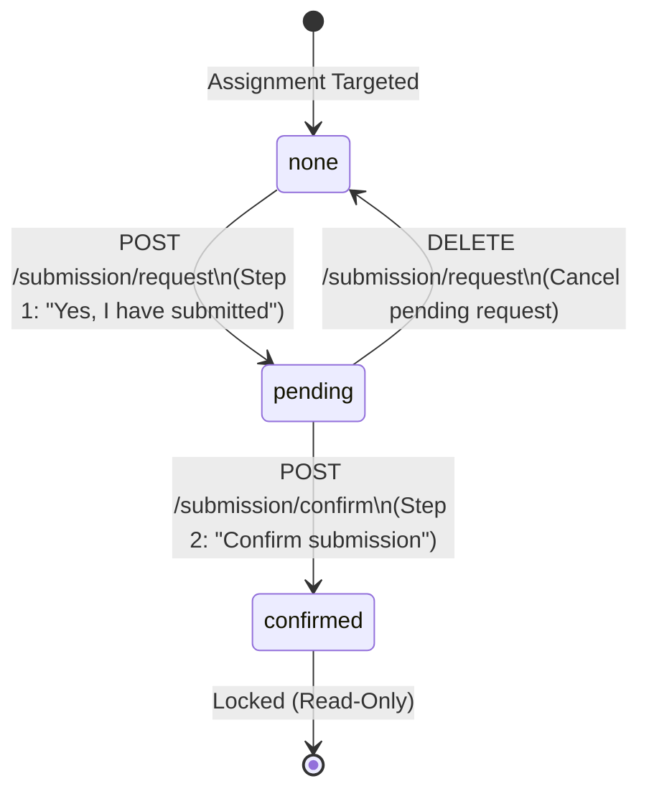

# Architectural Design & Decision Records (ADR)

This document outlines the architectural decisions, trade-offs, and design choices made during the design and development of the **Joineazy Student, Group & Assignment Management System**.

---

## 1. Context & Business Domain

At Joineazy, student assignments are executed in collaborative groups. Rather than students individually uploading binary files into an internal database, professors post public/private OneDrive submission URLs, and students upload deliverables externally before confirming on the LMS.

Key architectural challenges:
1. **Concurrency and Group Status**: Multiple students in a group must have a unified, synchronized view of assignment completion.
2. **Strict Verification**: Preventing accidental or fraudulent submission confirmations via server-enforced state transitions.
3. **Audience Targeting**: Allowing professors to broadcast assignments to the entire cohort or target specific subsets of groups.

---

## 2. Decision 1: Submissions Stored at Group Level (Not User Level)

### Problem
Should submission records be stored per individual student or per group?

### Decision
Submissions are stored **strictly per group** with a composite unique constraint:
`CONSTRAINT unique_assignment_group_submission UNIQUE (assignment_id, group_id)`

### Rationale
- Storing submissions per student creates data synchronization hazards (e.g. if one member submits, the others would require background batch updates).
- Student-wise views are derived on-demand by joining `group_members` with `submissions`.
- Audit integrity is preserved by recording both `requested_by` (who clicked Step 1) and `confirmed_by` (who clicked Step 2).

---

## 3. Decision 2: Two-Step Submission Verification State Machine

### Invariants Enforced by the Server:
1. `POST /submission/confirm` will return HTTP 409 Conflict if the current submission status is not `pending`.
2. A `confirmed` submission cannot be deleted, modified, or transitioned back to `pending`.
3. Only students who currently belong to a targeted group can initiate or confirm submissions.

---

## 4. Decision 3: Raw SQL with Parameterised Queries (No ORM)

### Decision
We use the native `pg` client with parameterised queries (`$1, $2, ...`) rather than heavyweight ORMs (such as Prisma or TypeORM).

### Rationale
- **Zero ORM cold-start latency**: On serverless Postgres (Neon) and container spin-ups, ORMs add noticeable schema-parsing delays.
- **Explicit query control**: Precise control over SQL `JOIN`s, transaction blocks (`BEGIN` / `COMMIT`), and aggregation queries (`COUNT(DISTINCT ...)`) ensures maximum database performance.
- **Injection safety**: Native parameterisation completely eliminates SQL injection risks.

---

## 5. Decision 4: Cold-Start Mitigation & Wake Banner

### Problem
Render free-tier web services spin down after 15 minutes of inactivity. The initial HTTP request can take 30 to 60 seconds to wake the service.

### Solution
1. A global interceptor in `frontend/src/api/client.js` detects when an active in-flight request exceeds 3,000 milliseconds.
2. It dispatches a custom window event (`joineazy:wake_state_change`) rendering a persistent top alert banner (`WakeBanner.jsx`) explaining the server spin-up process.
3. When the request resolves, the timer is cleared and the banner cleanly unmounts.
